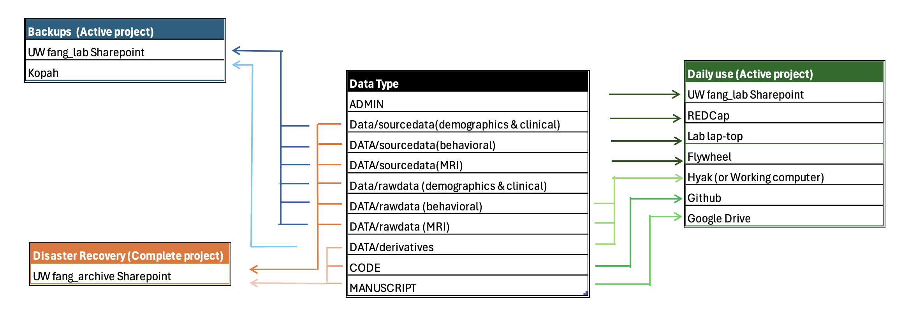

# The Storage Ecosystem

We utilize specific storage locations for specific tasks to ensure data safety and efficiency. We do not duplicate the entire directory tree everywhere.

Rule of Thumb:

* Storage Locations are for safe-keeping and "Sources of Truth"
* Active Locations are for computing, coding, and writing.

<figure><figcaption></figcaption></figure>

***

## Part 1: Active Use&#x20;

_These locations are temporary workspaces. Data here is the source, will be transient, changing, or being computed on._

### **1. UW active SharePoint (fang\_lab)**

* Role: Admin; Secure workspace for daily sensitive data handling.

```
Project_Name/
└── Full Access_Source Data and Admin/ #Lab's ADMIN Folder
└── Limited Access_PHI Data/ #Secure workspace for daily sensitive data handling

```

Sync Routine:&#x20;

* assessment video is uploaded here immediately (within 24 hours after gathered by rater)

### 2. UW REDCap **(**&#x44;emographics & Clinical/Survey Databas&#x65;**)**

* Role: The "Source of Truth" for Participant PHI, Demographics, and Survey responses.
* Storage Policy: "System of Record" (Data originates here). strictly NO permanent storage of exported PHI on local laptops. Never delete the original data.&#x20;
* Sync/QA Routine (Export): On the day of data collection, the RA must verify data completeness.&#x20;

### 3. Lab laptop **(**&#x42;ehavioral Databas&#x65;**)** <mark style="color:red;">TBD</mark>

* Role: The "Source of Truth" for task behavioral data.
* Storage Policy: "System of Record" (Data originates here). Never delete the original data.
* Sync Routine (Export):  On the day of data collection, the RA must verify data completeness, then upload the data to SharePoint.

### 4. Flywheel **(**&#x4D;RI Databas&#x65;**)**&#x20;

* Role: The "Source of Truth" for MRI data.
* Storage Policy: "System of Record" (Data originates here). Never delete the original data.
* Sync/QA Routine (Export):  On the day of data collection, the RA must verify data completeness. Data manager will upload the data to SharePoint every half a year (1/15; 7/15; by data manager).

### **5. Hyak (High-Performance Computing)**

* Role: Heavy computation and pipeline execution (fMRIPrep, FSL, PyTorch). <mark style="color:$danger;">No PHI</mark>.
* Storage Policy:&#x20;
  * Scratch Space: Not designed for storage. Use for active computation; transfer required outputs to Kopah. Clean up and only after verifying successful transfer and retention requirements.
  * Scrub Space: Temporal Code and intermediate results (Deleted automatically if not modified for 21 days).
*   Contents

    ```
    # in /gscratch/scrubbed/fanglab
    Project_Name/
    ├── DATA/
    │   ├── sourcedata/       # source to be process: DICOMs, Demographics, Clinical Accessments and Task Behavioral
    │   ├── rawdata/          # The Standard (BIDS NIfTIs & TSVs, standard and safe to share version)
    │   └── derivatives/      # Output of pipelines (preproc, stats)
    └── CODE/                 # Analysis scripts (Pulled from GitHub)
    # in /gscratch/fang
    Project_Name/
    ├── DATA/
    │   └── derivatives/      # Output of pipelines (preproc, stats)
    └── CODE/                 # Analysis scripts (Pulled from GitHub)
    ```
* Sync Routine: Transfer required outputs to Kopah once the processing was done, and clean up after verifying successful transfer and retention requirements.

### **6. GitHub (Code Versioning)**

* Role: Version control, reproducibility, and script sharing. <mark style="color:$danger;">No PHI</mark>.
* Storage Policy: "Code Only" (Strictly NO data).
*   Directory Subset:

    ```
    Project_Name/
    └── CODE/                 # .py, .sh, .ipynb files
    ```
* Workflow: develop code locally -> push to GitHub -> pull to Hyak for execution.

### **7. Google Drive (Collaboration)**

* Role: Collaborative writing, administrative tracking, and presentations. <mark style="color:$danger;">No PHI</mark>.
* Storage Policy: "Documents Only" (Strictly NO Patient Data/PHI).
*   Directory Subset:

    ```
    Project_Name/
    └── MANUSCRIPT/           # Drafts, Tables, Figures for papers
    ```


***

## Part 2: The Backups for active projects

_These locations are primarily for data preservation for on-going projects_

### **1. UW active SharePoint (Behavioral  and MRI, fang\_lab SharePoint)**

* Role:&#x20;
  * Secure, HIPAA-compliant, immutable backup for ALL unrecoverable source data (MRI + Behavioral).
  * Secure, HIPAA-compliant, immutable backup for ALL unrecoverable raw data (MRI + Behavioral ), processed to excluded HIP info and should be ready for share. &#x20;
* Storage Policy: "Raw Assets Only" (No derivatives, no scratch files).
*   Contents:

    <pre><code>Project_Name/
    └── Full Access_Source Data and Admin/
    │   ├── sourcedata/       # The Safety Net (DICOMs and Task Behavioral)
    │        ├── MRI(<a data-footnote-ref href="#user-content-fn-1">dicom</a>)
    │        └── <a data-footnote-ref href="#user-content-fn-2">behavioral</a>
    └── Limited Access_Deidentified data/
            ├── MRI(nifit) # The Standard (BIDS NIfTIs &#x26; TSVs)
            └── behavioral  
      
    </code></pre>
*   Sync Routine:&#x20;

    * should be uploaded here by data manager every half year (1/15; 7/15; by data manager)


    ### **2. Kopah (**&#x53;3-Compatible Storag&#x65;**)**

    * Role: Maintain as a protected backup copy of the reday-to-analysis derivative outputs. Never delete or overwrite the retained files. <mark style="color:$danger;">No PHI</mark>.
    * Storage Policy:&#x20;
      * Retain finalized, analysis-ready derivatives.
      * Do not overwrite or delete retained files during active project storage.
      * Store updated outputs as new versions when necessary.
      * Remove files only after successful archival, verification, and confirmation that retention requirements have been met.
    *   Contents

        ```
        # in s3://fang/
        Project_Name/
        ├── DATA/
            └── derivatives/      # Output of pipelines (preproc, stats)
        ```
    * Sync Routine:&#x20;
      * Upon project completion, transfer required outputs to the lab's long-term storage on SharePoint.
      * Verify successful transfer and data integrity.
      * Clean up Kopah storage only after confirming that archival and retention requirements have been satisfied.

***

## Part 3: The Backups for complete projects (disaster recovery, fang\_achive)

_These locations serve as the authoritative archival copies of completed research projects, ensuring long-term data preservation, reproducibility, and disaster recovery. Archived files should remain protected from accidental modification or deletion._

### **UW storage SharePoint**&#x20;

* Role: Serve as the central repository for long-term preservation of completed research projects, including:
  * **Source and Raw Data:** Original source files and standardized research datasets.
  * **Research Code:** Final, versioned code used for preprocessing, analysis, and visualization.
  * **Derived Data and Results:** Essential analysis-ready datasets and outputs required to reproduce reported findings.
  * **Research Documentation:** Final manuscripts, supporting materials, and essential project documentation.
* Storage Policy:&#x20;
  * Preserve original source data and the designated standardized raw-data copies without modification.
  * Archive a frozen, versioned release of the code used for the final analyses, including required configuration files and software environment specifications.
  * Retain final analysis-ready datasets and essential outputs needed to reproduce published results.
  * Preserve final manuscripts, supplementary materials, and essential project documentation.
  * Restrict access according to data sensitivity and institutional policies.
  * Do not overwrite or delete archived files except through an approved, documented retention or correction process.
*   Contents:

    ```
    Project_Name/
    ├── DATA/
    │   ├── sourcedata/            # Original source files
    │   │   ├── clinical_assessments/
    │   │   ├── demographics/
    │   │   ├── mri_dicom/
    │   │   └── behavioral/
    │   │
    │   ├── rawdata/               # Standardized raw data (BIDS)
    │   │   ├── sub-*/
    │   │   ├── phenotype/
    │   │   ├── dataset_description.json
    │   │   └── participants.tsv
    │   │
    │   └── derivatives/           # Final analysis-ready data and results
    │       ├── preprocessing/
    │       └── analysis/
    │
    ├── CODE/                      # Frozen research code release
    │   ├── scripts/
    │   ├── configs/
    │   └── environment/
    │
    └── DOCS/                      # Final research documentation
        ├── manuscripts/
        ├── supplementary_materials/
        └── project_documentation/
    ```
* Sync Routine **(Upon Project Completion):**
  * **Final Archival:** Transfer source data, raw data, final code, essential derivatives, results, and documentation to SharePoint.
  * **Verification:** Confirm transfer completeness and data integrity.
  * **Archive Protection:** Apply appropriate access controls, versioning, and retention policies.
  * **Cleanup:** Remove redundant copies from Hyak and Kopah only after successful archival verification.
  *   **Recovery:** Periodically verify archive accessibility and recoverability.


[^1]: [https://uwnetid.sharepoint.com/:f:/r/sites/i-focus\_fang\_lab/Shared%20Documents/i-focus/DATA/sourcedata/dicom?csf=1\&web=1\&e=rdQpSy](https://uwnetid.sharepoint.com/:f:/r/sites/i-focus_fang_lab/Shared%20Documents/i-focus/DATA/sourcedata/dicom?csf=1\&web=1\&e=rdQpSy)

[^2]: [https://uwnetid.sharepoint.com/:f:/r/sites/i-focus\_fang\_lab/Shared%20Documents/i-focus/DATA/sourcedata/task\_behavioral?csf=1\&web=1\&e=OSIriY](https://uwnetid.sharepoint.com/:f:/r/sites/i-focus_fang_lab/Shared%20Documents/i-focus/DATA/sourcedata/task_behavioral?csf=1\&web=1\&e=OSIriY)
